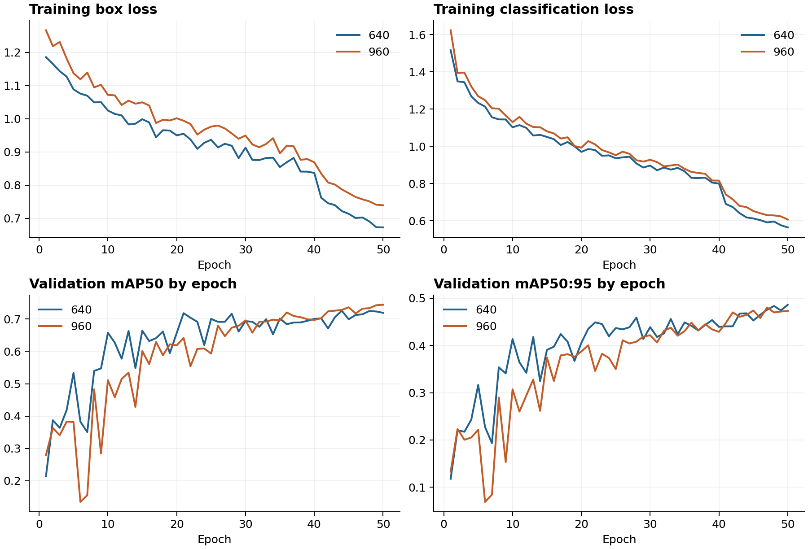
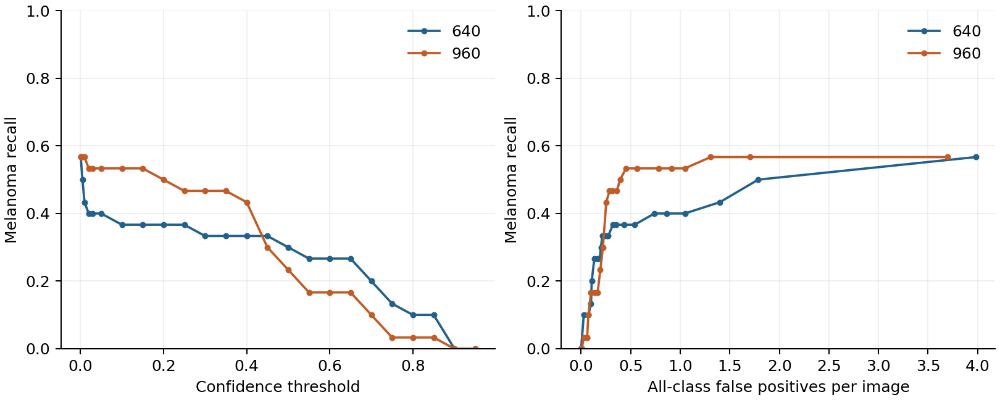
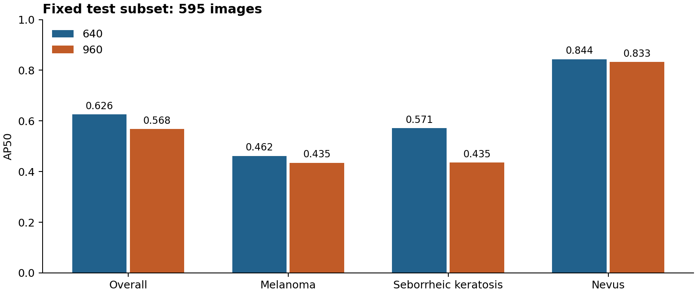

# Skin Lesion Detection: Does Higher Resolution Justify Its Cost?

**COMP3710 Pattern Recognition | Student s4849402 | Section 2.3 | Normal difficulty**

## 1. Problem, prototype and main finding

This individual project develops a detector that localizes and classifies annotated dermoscopic lesions as melanoma, seborrheic keratosis or nevus. The intended user is a reviewer inspecting model-proposed boxes, not an autonomous diagnostic service. The engineering dilemma is whether greater lesion sensitivity can be obtained without excessive false alarms or computing cost.

A COCO-pretrained YOLOv8n fine-tuned at 640 pixels is the standard baseline. The proposed controlled alternative uses the same architecture at 960 pixels. Higher resolution slightly improved validation AP50, but did not improve overall performance on the independent, exact-duplicate-filtered test subset. Test mAP50 was 0.6257 for 640 and 0.5675 for 960. At fixed confidence 0.15, 960 detected four additional melanoma lesions while producing 30 additional melanoma-labelled false positives. Assessment follows the assignment's test localization target of IoU >= 0.8, classification performance, and sensitivity/false-alarm trade-off; no additional numerical recall pass criterion is imposed.

## 2. Feasibility Review: pre-training plan

**Need and scope.** Build a research assistant that proposes lesion boxes and classes for human inspection. Use ISIC images with matched masks and diagnosis labels; do not claim validation for whole-body screening or unannotated multi-lesion scenes.

**Acceptance criteria.** (1) Document leakage-controlled splits and audit duplicate images. (2) Report mAP50, mAP50:95, per-class precision/recall and localization, investigating the assignment's IoU >= 0.8 target. (3) Compare a working standard detector with a controlled modification under the same splits and training budget. (4) quantify validation confidence-threshold trade-offs and inspect 3-5 failures. (5) Measure memory, parameters and runtime within available GPU resources.

**Choice and course basis.** Fine-tune pretrained YOLOv8n as the baseline, then change input resolution while retaining architecture and other settings. Relevant concepts are convolutional feature extraction, multiscale representations, transfer learning, supervised losses and held-out evaluation. Masks supply bounding-box geometry; diagnosis CSVs supply classes.

**Initial evidence.** Auditing identified 2,000 training labels and 150 validation labels, including class imbalance. One real example per class was matched to its mask, converted to a box and visually checked. A GPU tensor calculation was verified in the school GPU Lab. At that point no trained-model performance had been established.

**Risks, budget and fallback.** Patient identifiers were absent from inspected metadata; clarification was needed for the split protocol. Small or faint lesions, hair/ruler artifacts, class imbalance and GPU limits were anticipated. A short training run would measure memory/time before a baseline and one controlled experiment. Reduce batch/size if needed or use school compute. The immediate next experiment was annotation alignment followed by a short baseline run.

**Subsequent clarification.** The student reported permission to use official ISIC splits. This is recorded as the split protocol; patient independence was not independently verified from identifiers. Exact duplicates discovered later were handled explicitly below. Check-off completion is recorded by the tutor separately; this report does not fabricate a consultation record.

## 3. Data preparation and leakage control

The official ISIC 2017 challenge provides image archives, Part 1 binary masks and Part 3 diagnosis CSVs [1,2]. Image IDs match the three sources. Melanoma flag 1 maps to class 0, seborrheic-keratosis flag 1 to class 1, and both flags 0 to class 2 (nevus). This mapping applies to this specific three-class dataset, not arbitrary ISIC files.

For each nonempty mask, the minimum and maximum foreground coordinates define an enclosing rectangle; right/bottom coordinates are exclusive before conversion to normalized center-x, center-y, width and height. Image/mask dimensions must agree. Empty masks, duplicate IDs, inconsistent classes and unverified split memberships trigger errors. Disconnected mask foreground is enclosed as one lesion and requires review.

| Class | Training after audit | Validation | Test after audit |
|---|---:|---:|---:|
| melanoma | 374 | 30 | 117 |
| seborrheic keratosis | 254 | 42 | 90 |
| nevus | 1,371 | 78 | 388 |
| Total | 1,999 | 150 | 595 |

Original official split sizes were 2,000/150/600. Decoded RGB pixels and dimensions were hashed, not merely filenames. Training ISIC_0012970 duplicated validation ISIC_0012127 (both nevus), so the training member was excluded. Original files were retained.

Before any final test scoring, five test images were excluded under the documented contamination rule: ISIC_0015982 and ISIC_0016018 overlapped training; ISIC_0016002 overlapped validation; ISIC_0015979 and ISIC_0016001 repeated other test images. All five were nevus. Neither exclusions nor thresholds were chosen from test performance. Results therefore concern a **595-image decontaminated test subset**, not the untouched official benchmark. Exact hashing does not guarantee removal of near duplicates or establish patient identity separation.

Augmentation is applied after splitting and only during training. The framework performs image/box geometry transformations together. Validation sets choose checkpoints and operating rules; test data do not update parameters or select thresholds. Full split/exclusion records are retained in audit JSONs. No raw dataset or model weights are committed to Git.

## 4. Model and working principles

YOLOv8n is a single-stage, CNN-based detector [3]. Its backbone uses convolution/C2f feature extraction and spatial-pyramid pooling; its neck fuses multiple scales using upsampling, concatenation and downsampling. An anchor-free detection head predicts classes and box-distance distributions at strides 8, 16 and 32. At 640 pixels, these scales have 80x80, 40x40 and 20x20 locations. Training labels are targets, not inputs to inference.

The model flow is RGB image -> aspect-preserving resize/padding and 0-1 scaling -> backbone -> multiscale neck -> three-class detection head -> box decoding, confidence filtering and class-aware NMS -> original-image-coordinate predictions. The pretrained COCO categories do not diagnose lesions: modules.py constructs a genuine three-class head and transfers compatible weights. Merely changing class names would be insufficient. Network and loss implementations are supplied by Ultralytics, not claimed as original work.

The standard loss is a weighted sum: L = 7.5 L_CIoU + 0.5 L_BCE + 1.5 L_DFL. CIoU penalizes box overlap/position/aspect mismatch; BCEWithLogits supervises assigned class scores; Distribution Focal Loss learns box-side distance distributions [4]. DFL is not a class-imbalance focal-loss intervention. No custom objectness loss or attention module was added.

## 5. Experimental protocol

| Setting | Baseline | Controlled alternative |
|---|---|---|
| Model / initialization | YOLOv8n COCO pretrained | Same |
| Input size | 640 | 960 |
| Epochs / batch | 50 / 8 | 50 / 8 |
| Seed / workers | 42 / 2 | 42 / 2 |
| Optimizer / initial LR | AdamW / 0.001 | Same |
| Weight decay / final LR factor | 0.0005 / 0.01 | Same |
| Warm-up | 3 epochs | Same |
| Early stopping / mixed precision | Disabled / disabled | Same |

Both runs restart from the same pretrained initialization and class-head initialization procedure. No progressive training from the baseline to the alternative is used. Fixed seed/deterministic settings reduce variability but do not establish cross-hardware bitwise reproducibility. There is only one seed per configuration.

Recorded training augmentation included horizontal flip probability 0.5, translation 0.1, scale 0.5, HSV gains 0.015/0.7/0.4 and mosaic probability 1.0, closed in the final ten epochs; mixup and cutmix were zero. These are framework settings, not claimed clinically optimized color transforms. Original args.yaml files contain the complete settings. Same epochs do not mean same FLOPs or wall-clock budget.

Best checkpoints were selected with the installed validator's fitness (mAP50:95), not test results. CSV maxima occur at epoch 50 (640) and 47 (960); standalone validation can differ slightly from in-training values after serialization and validation execution. The standalone evaluation JSONs are used consistently below.



## 6. Metrics and threshold selection

IoU is intersection area divided by union area. A true positive requires the correct class, sufficient IoU and a unique ground-truth match. AP integrates precision-recall behavior; mAP averages classes. AP50 uses IoU 0.5; AP50:95 averages IoU thresholds 0.50 to 0.95 in steps of 0.05. AP uses a low score floor of 0.001, not the deployed confidence threshold.

Two related protocols are reported explicitly. The **Ultralytics validator** computes AP and its own summary P/R operating point. The **custom inference operating analysis** consumes detector.predict outputs (single class per candidate, class-aware NMS IoU 0.7), filters confidence 0.15, then performs class-aware, confidence-ordered one-to-one matching. The validator's multilabel candidate handling and operating-point choice can differ; its P/R must not be substituted for the fixed-threshold P/R below. No test-time augmentation was used.

The validation scan first covered 0.05-0.95 and was then exploratorily extended down to 0.001. Maximum observed melanoma recall was 17/30 (0.567): 640 at 0.001 required 3.980 all-class FP/image, while 960 at 0.01 required 1.307. A common confidence of 0.15 was subsequently chosen as an **exploratory validation comparison**: 640 gave melanoma recall 0.367 and 0.433 all-class FP/image; 960 gave 0.533 and 0.453. This choice was fixed before test scoring and is not claimed to be a uniquely optimal or clinically validated threshold. Threshold curves describe the sensitivity/false-alarm trade-off without an additional recall pass criterion. Historical threshold JSONs retain an earlier optional development constraint for provenance; their met/unmet status is not an assignment verdict.



The strict-IoU analysis reports correct-class recall at IoU >= 0.8, including missed lesions in the denominator. This is not mean matched-box IoU; the separate mean-IoU supplement below explicitly states its denominators. No score is interpreted as a calibrated probability of disease.

## 7. Quantitative results

| Aggregate AP | 640 | 960 |
|---|---:|---:|
| Validation mAP50 | 0.7192 | 0.7307 |
| Validation mAP50:95 | 0.4847 | 0.4807 |
| Test mAP50 | 0.6257 | 0.5675 |
| Test mAP50:95 | 0.3721 | 0.3321 |

| Test class | AP50, 640 | AP50, 960 | AP50:95, 640 | AP50:95, 960 |
|---|---:|---:|---:|---:|
| melanoma | 0.4621 | 0.4348 | 0.2478 | 0.2221 |
| seborrheic_keratosis | 0.5713 | 0.4353 | 0.3480 | 0.2762 |
| nevus | 0.8437 | 0.8326 | 0.5205 | 0.4981 |



The 960 validation AP50 gain did not generalize to this test subset. Overall test AP50 decreased by 5.82 percentage points, and AP50:95 by 3.99 points. Possible explanations include validation sampling variability and sensitivity to scale/augmentation; these were not causally tested. No significance claim is made from one run and split.

| Fixed confidence 0.15, IoU >= 0.5 | 640 | 960 |
|---|---:|---:|
| All-class TP / FP / FN | 448 / 306 / 147 | 409 / 332 / 186 |
| All-class precision / recall (micro) | 0.5942 / 0.7529 | 0.5520 / 0.6874 |
| All-class FP per image | 0.5143 | 0.5580 |
| Melanoma TP / FP / FN | 57 / 72 / 60 | 61 / 102 / 56 |
| Melanoma precision / recall | 0.4419 / 0.4872 | 0.3742 / 0.5214 |
| Seborrheic keratosis precision / recall | 0.4155 / 0.6556 | 0.3204 / 0.6444 |
| Nevus precision / recall | 0.6874 / 0.8557 | 0.7305 / 0.7474 |

At this operating point 960 has four more melanoma true positives and 30 more melanoma-labelled false positives. Those aggregate differences do not mean the same 57 cases were nested within the other model's 61; paired predictions are required for such a claim.

| Strict localization: confidence 0.15, IoU >= 0.8 | 640 | 960 |
|---|---:|---:|
| All-class TP / FP / FN | 285 / 469 / 310 | 234 / 507 / 361 |
| All-class recall | 0.4790 | 0.3933 |
| Melanoma TP / FP / FN | 33 / 96 / 84 | 30 / 133 / 87 |
| Melanoma recall | 0.2821 | 0.2564 |
| Seborrheic keratosis recall | 0.3778 | 0.4000 |
| Nevus recall | 0.5619 | 0.4330 |

### Supplement: mean localization IoU

These CPU-only statistics use the saved fixed-threshold test predictions and official masks/diagnosis labels, restricted to the same 595 IDs. Original 10-decimal YOLO box coordinates were reconstructed from mask dimensions. Every per-class TP/FP/FN at IoU 0.5 and 0.8 exactly reproduces the school evaluation, and the diagnosis CSV hash matches the test audit.

| Class | Matched mean IoU, 640 | Matched mean IoU, 960 | All-GT mean, 640 | All-GT mean, 960 |
|---|---:|---:|---:|---:|
| melanoma | 0.7943 | 0.7697 | 0.3869 | 0.4013 |
| seborrheic_keratosis | 0.8071 | 0.8089 | 0.5291 | 0.5213 |
| nevus | 0.8262 | 0.8130 | 0.7069 | 0.6077 |
| overall | 0.8196 | 0.8060 | 0.6171 | 0.5540 |

Matched mean is conditional on correct-class one-to-one matches at IoU >= 0.5 and confidence >= 0.15. All-GT mean divides the same IoU sum by all ground truths, assigning zero to misses or incorrect-class detections. Conditional means exclude difficult misses and false positives and can therefore appear favorable despite inadequate sensitivity. Interpret any 0.8 comparison with that denominator explicitly; it is not evidence that every lesion meets the localization target.

Against the assignment target of IoU >= 0.8, the matched means for seborrheic keratosis and nevus exceed 0.8 for both models, but melanoma is below 0.8 (640: 0.7943; 960: 0.7697). All-GT means are below 0.8 throughout. Therefore neither model establishes that the per-class localization target is fully met; the report presents the shortfall rather than treating the overall conditional mean as sufficient.

## 8. Resource cost

Both configurations ran on the same A10G environment. Parameters refer to the unfused three-class model; the fused inference summary reports 3,133,193 parameters.

| Input | Parameters | Timed hours | Peak allocated GiB | Validator inference ms/image | Derived inference-only images/s |
|---|---:|---:|---:|---:|---:|
| 640 | 3,138,489 | 1.010 | 1.663 | 1.280 | 781.4 |
| 960 | 3,138,489 | 1.174 | 3.592 | 2.317 | 431.5 |

Timed hours come from training_summary.json around the training call, including its validation/checkpoint work; framework console epoch totals were 1.006 and 1.170 hours. Peak memory is PyTorch maximum allocated GPU memory after the on-train-start reset, not total reserved memory or device-wide VRAM consumption. The higher-resolution run used about 2.16 times the allocated peak memory and 16.2% more timed wall-clock.

The speed values are the framework's batched final-test validator measurements, not a repeated standalone latency benchmark. Derived images/s is simply 1000 divided by the recorded inference component. It excludes preprocessing, NMS, disk access and plotting; therefore it is not mobile or clinic end-to-end FPS. Recorded preprocessing/inference/postprocessing were 1.065/1.280/1.066 ms (640) and 2.148/2.317/1.074 ms (960). A stronger deployment claim would require a dedicated repeated benchmark.

## 9. Failure-case autopsies

The following five examples are **validation** diagnostics for 960 at confidence 0.15. They were selected for error-type diversity, prioritizing melanoma within groups and then image ID; they are not a random sample. Green is ground truth and red is prediction. Exact values were checked against the original exported JSONs. Visible artifacts are observations; their causal effect is a hypothesis unless tested.

### Case 1: ISIC_0012099 - localized melanoma misclassified as nevus


The prediction overlaps the true box at IoU 0.936 but labels it nevus with confidence 0.811. This is class confusion, not failure to find the region. The lesion is relatively small in a larger field; a ruler is visible elsewhere, but there is no evidence that it caused the mistake. Raising the threshold would discard or retain the same incorrect label, not repair it. Audit melanoma/nevus confusion and lesion-size strata; do not equate confidence with correctness.

### Case 2: ISIC_0012143 - central-region undercoverage


The seborrheic-keratosis class is correct at confidence 0.808, but IoU is 0.338. The prediction covers the prominent center while the annotation includes a broader peripheral extent. Hair and weaker peripheral contrast are visible; center-biased features or annotation ambiguity are hypotheses, not proven causes. Review the source mask and boundary extent. High class confidence does not guarantee localization utility.

### Case 3: ISIC_0012151 - true positive plus wrong-class duplicate


The melanoma prediction is correct (confidence 0.711, IoU 0.942), but a second overlapping box predicts seborrheic keratosis (0.223, IoU 0.930), adding a false positive. This is consistent with class-aware NMS retaining boxes of different classes. Class-agnostic suppression is a possible future experiment, but was not retroactively applied to test data and could suppress legitimate nearby lesions in other settings.

### Case 4: ISIC_0012254 - no retained detection


No box survives 0.15 for the annotated seborrheic keratosis. The diffuse, weakly delineated appearance is a candidate difficulty factor. Saved predictions show low-scoring candidates did exist: the highest was nevus at 0.0888; the highest correct-class score was only 0.00119. Thus the overlay does not mean the network proposed nothing, and simply lowering the threshold need not restore a correctly classified, well-localized detection. A missing detection is not a reliable negative diagnosis.

### Case 5: ISIC_0013501 - moderate overlap fails strict localization


The melanoma label is correct at confidence 0.667, but the narrower/shorter predicted box has IoU 0.745. It passes IoU 0.5 and fails 0.8, illustrating why AP50 alone is insufficient. Uneven pigmentation, hair and blue peripheral markings are visible; their causal roles were not isolated. Analyze box extent separately from classification and review the original mask rather than invent a physiological explanation.

## 10. Engineering recommendation and limits

For this measured prototype, retain the 640 baseline as the more economical overall configuration. The 960 alternative provides a limited melanoma sensitivity trade-off at 0.15, not an overall improvement. The assignment's IoU >= 0.8 target is assessed per class with explicit denominators below the results tables; an overall matched-box average alone does not establish that all classes meet it. Misses, classification errors and false alarms remain material limitations, and outputs require review. Do not translate detection confidence directly into malignancy probability or biopsy decisions.

Limitations are single-seed experiments, a small 150-image development set, class imbalance, dermoscopic mostly single-lesion images, absence of independently checked patient identifiers, exact-only duplicate detection, and no calibration or subgroup fairness audit. The five examples illustrate symptoms, not causal proof. Annotations and real-world boundaries may be ambiguous. Future class balancing, calibration or architecture/postprocessing changes require new validation and independent evaluation, not further tuning on this final test set.

## 11. Reproduction and code usage

Run commands from this project directory. The executed versions were Python 3.10.21, PyTorch 2.14.0+cu130, torchvision 0.29.0 and Ultralytics 8.4.191. School installation output also recorded NumPy 2.2.6, Pillow 12.3.0 and PyYAML 6.0.3. Install a CUDA-compatible PyTorch build first, then requirements.txt. Local software checks used CPU PyTorch 2.15.0 and do not reproduce the school timing measurements.

```
python -m pip install -r requirements.txt
python check_environment.py --training
python -m unittest discover -s tests -v
```

The initial CUDA addition check passed but convolution failed because a cuDNN shared library could not load. Adding installed NVIDIA library directories to the current terminal's LD_LIBRARY_PATH resolved forward/backward convolution. The adjustment is environment-specific and is documented in RUN_GUIDE.md; new terminals should verify convolution, not merely CUDA availability.

Download and extract official train/validation images, Part 1 masks and Part 3 CSVs outside Git. Use the decoded-duplicate audit described in RUN_GUIDE.md, then:

```
python prepare_isic.py --source /data/isic2017/raw --output /data/isic2017/yolo --split-evidence "Use official ISIC 2017 splits" --duplicate-audit /data/isic2017/duplicate_audit.json
python train.py --data /data/isic2017/yolo/data.yaml --output runs/baseline640 --epochs 50 --imgsz 640 --batch 8 --device 0 --workers 2
python train.py --data /data/isic2017/yolo/data.yaml --output runs/compare960 --epochs 50 --imgsz 960 --batch 8 --device 0 --workers 2
```

Prepare the official Test_v2 archives after fixing the protocol. The hard-link export requires source and output on a supporting filesystem. Exclusions are applied before scores, with conflicts causing an error:

```
python prepare_test.py --archives /data/isic2017/archives --raw /data/isic2017/test_raw --training-data /data/isic2017/yolo --output /data/isic2017/test_yolo
python evaluate.py --weights runs/baseline640/weights/best.pt --data /data/isic2017/test_yolo/data.yaml --output runs/test640_final --split test --imgsz 640 --operating-conf 0.15 --device 0
python evaluate.py --weights runs/compare960/weights/best.pt --data /data/isic2017/test_yolo/data.yaml --output runs/test960_final --split test --imgsz 960 --operating-conf 0.15 --device 0
python predict.py --weights runs/baseline640/weights/best.pt --source /path/to/new_images --output runs/example_predictions --imgsz 640 --conf 0.15 --device 0
```

Output directories must be new. Prediction outputs include original-coordinate boxes, class IDs/names, confidence and overlays, including empty detections. train.py does not automatically score test data, and evaluate.py rejects test threshold sweeps. An inference example is `{"class_id": 2, "class_name": "nevus", "confidence": 0.811, "xyxy": [...]}`: this schematic follows the incorrect prediction in Case 1, not a successful diagnosis.

| File | Responsibility |
|---|---|
| modules.py | Class/seed configuration, transfer and three-class-head checks, checkpoint loading |
| dataset.py / prepare_isic.py | Mask-to-box conversion, official membership and duplicate handling |
| train.py | Training/validation, saved settings, resource records, best/last checkpoints |
| predict.py | Trained-weight inference and JSON/overlay export |
| evaluate.py / analyze_failures.py | AP, fixed-threshold metrics, validation scans and reviewed-case candidates |
| prepare_test.py | Audited, nonduplicating test preparation |

Download the exact evaluated checkpoints from the [skinlesion-v1 release](https://github.com/lbxy128/PatternAnalysis-2026/releases/tag/skinlesion-v1), using the [trained-weight ZIP](https://github.com/lbxy128/PatternAnalysis-2026/releases/download/skinlesion-v1/COMP3710_s4849402_weights.zip). Release assets are separate from the Git source history; model weights remain excluded from commits. Extract baseline640_best.pt and compare960_best.pt into a local weights/ directory. The archive includes manifest.json with checkpoint checksums and README.txt with inference commands. No retraining is required to run these checkpoints. For example:

```bash
python predict.py --weights weights/baseline640_best.pt --source /path/to/new_images --output runs/released640_predictions --imgsz 640 --conf 0.15 --device 0
```

For the other checkpoint use weights/compare960_best.pt and --imgsz 960; use --device cpu for CPU inference. The ZIP SHA-256 is 29eb67471074e00c9cbd6636894dda0f6cac3a9be7878bb8507bd8f279a3853a. Checksum identity, not the local folder name, establishes which model was tested:

```
640 best.pt SHA-256:
6498adb6039e8b8c6e807b0958453f624ca7a3505c6ca25d5851eba2cc40defe
960 best.pt SHA-256:
5587c73b489b702ba90e24c51524249e254bee251c8adb92fa98768af731f721
```

## 12. Artificial Intelligence Usage Disclosure

OpenAI Codex assisted with assessment interpretation, conceptual explanations, code scaffolding and implementation, debugging, experiment commands, plotting, and drafting this report. Third-party model/training/metric implementations are Ultralytics/PyTorch and are cited separately. The student executed the school GPU experiments, supplied outputs and the final backup, and reported tutor guidance on splits.

Verification performed during development included synthetic mask/label/leakage tests, an actual CPU train/save/reload/inference/evaluation integration check, a GPU convolution forward/backward check, complete archive/annotation audits, exact-duplicate exclusion records, 18 current logic tests, visual review of real overlays, and matching original checkpoint SHA-256 values against both training summaries and final evaluations. Before report finalization, the four central local model/train/evaluate/predict files were byte-compared with the executed backup snapshots. The subsequent evaluate.py revision removes the default recall gate from descriptive validation sweeps; it does not change training, AP, fixed-confidence matching or saved test results. These checks do not constitute a clinical validation. The student remains responsible for understanding and defending every equation, code decision and empirical claim.

## 13. References

[1] ISIC 2017 Challenge data and official archives: https://challenge.isic-archive.com/data/#2017

[2] Codella et al. Skin Lesion Analysis Toward Melanoma Detection: A Challenge at ISBI 2017. https://arxiv.org/abs/1710.05006

[3] Ultralytics YOLOv8 model documentation and implementation: https://docs.ultralytics.com/models/yolov8/ ; https://github.com/ultralytics/ultralytics

[4] Ultralytics detection loss implementation: https://docs.ultralytics.com/reference/utils/loss/ ; Li et al., Generalized Focal Loss (DFL): https://arxiv.org/abs/2006.04388

[5] Zheng et al. Distance-IoU Loss: Faster and Better Learning for Bounding Box Regression (CIoU). https://arxiv.org/abs/1911.08287

[6] COMP3710 Report v2.5, Sections 2.3 and 3-6, course assessment specification.

Auditable experiment metadata, CSVs and JSONs are in reports/evidence/; the consolidated verified table source is reports/verified_results.json. Raw images, full predictions, local environments, data caches and weights are excluded from repository commits.
