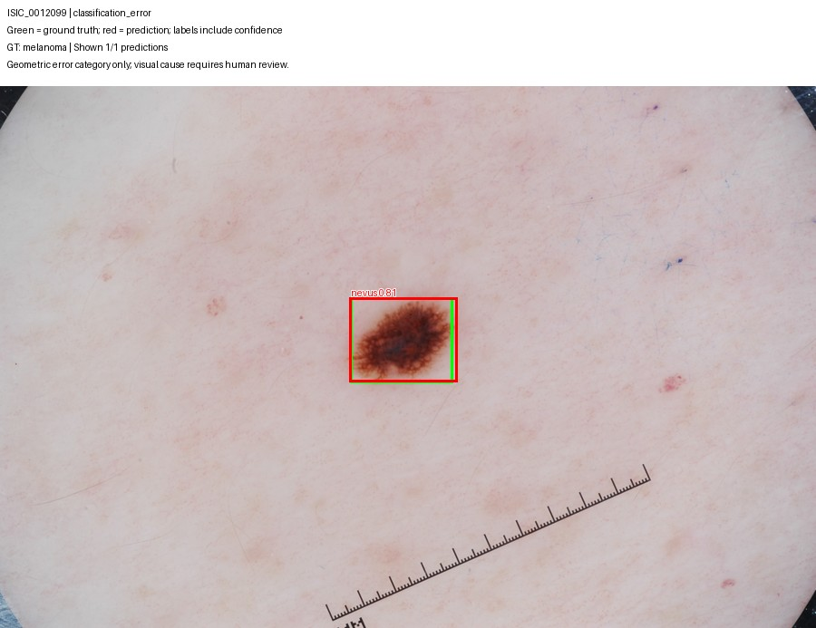
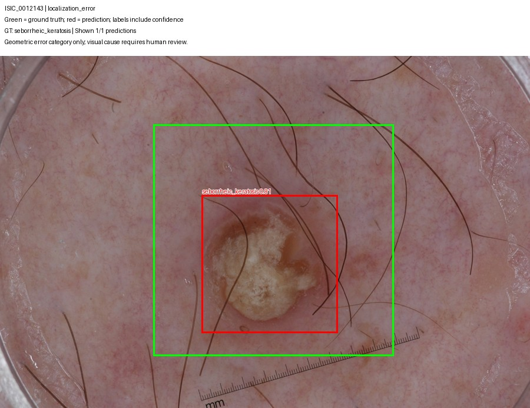
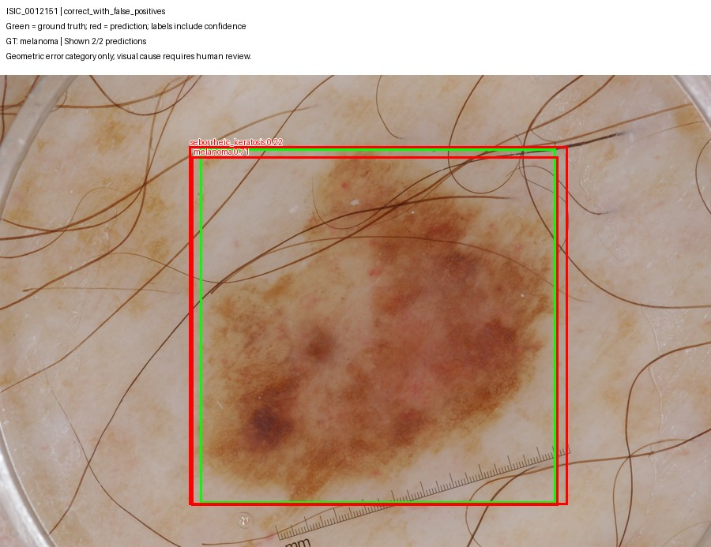
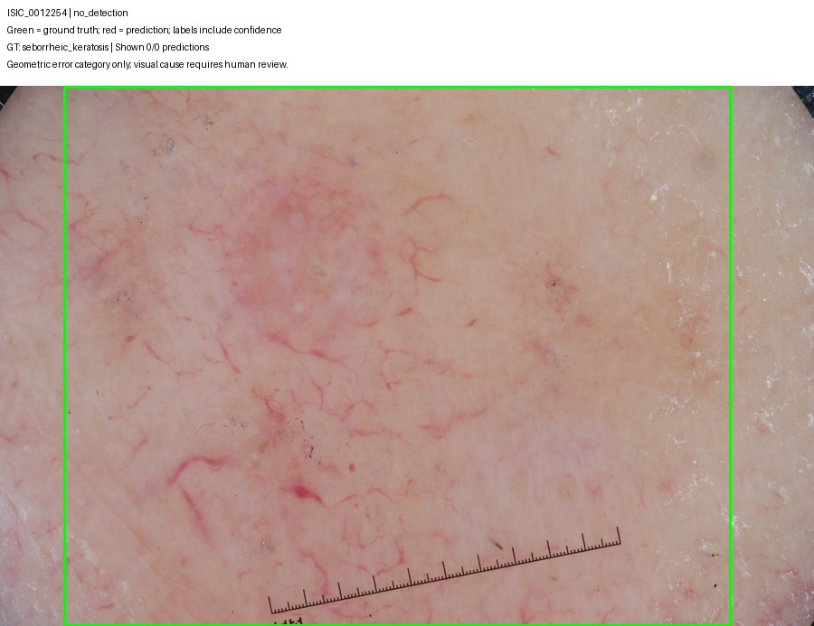
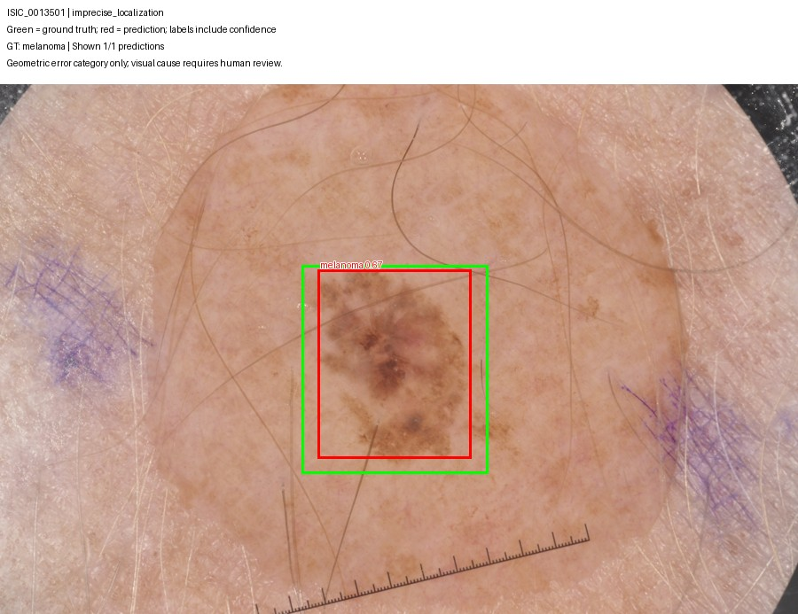

# Qualitative validation error analysis

Model: YOLOv8n fine-tuned at 960 input resolution. Confidence threshold: 0.15. Dataset: ISIC 2017 validation split, 150 images. These examples are validation diagnostics, not final test results.

Evidence: exported overlays and the original school-side `failure_summary.json`, now verified in final_results_backup.zip. Scores below are rounded overlay values. Verified geometric IoUs are 0.9363 (0012099, wrong class), 0.3378 (0012143), 0.9423 (0012151, melanoma box) and 0.7451 (0013501). Ground-truth diagnoses are dataset annotations, not diagnoses inferred in this review. Green boxes are ground truth and red boxes are predictions.

The automated selector sought different error categories, prioritized melanoma within categories, and ordered candidates by image ID. The five images illustrate possible failure modes; they are not a random sample or a basis for estimating prevalence.

## 1. ISIC_0012099 — accurate localization with an incorrect class

**Observed:** The ground-truth class is melanoma. A single prediction labels the lesion as nevus with displayed confidence 0.81. Its box closely overlaps the annotated box. The exported category is `classification_error`, meaning an incorrect-class box overlaps the target at IoU >= 0.5 and no qualifying correct-class match is present at this operating point.

**Interpretation:** This is primarily a class-discrimination failure rather than complete failure to find the lesion. The lesion occupies a small portion of a larger image. A ruler and small peripheral markings are visible, but the image does not show that either caused the classification error. The relatively high incorrect-class score also demonstrates why confidence alone is insufficient to establish correctness; one example cannot establish dataset-wide miscalibration.

**Engineering implication:** Audit melanoma-versus-nevus confusion separately from localization. Raising a confidence threshold alone would retain this incorrect prediction until the threshold exceeded its displayed score and would then discard the detection, not correct its class. Small-lesion scale analysis and class-balanced training are possible future experiments, not demonstrated fixes.

## 2. ISIC_0012143 — correct class, under-sized localization

**Observed:** Both ground truth and prediction are seborrheic keratosis; displayed prediction confidence is 0.81. The red box encloses the prominent central region, while the green annotation extends substantially farther around it. The `localization_error` category indicates no same-class IoU >= 0.5 match at the chosen threshold.

**Interpretation:** The prediction undercovers the provided target extent. The peripheral appearance is less distinct than the central region, and hairs cross the image. Reliance on the visually salient center is a plausible explanation, but neither attention to the center nor a causal hair effect was measured. The original mask should also be reviewed before treating the annotated extent as visually unambiguous.

**Engineering implication:** Classification confidence is not a measure of box accuracy. Inspect IoU and boundary extent explicitly. Do not apply arbitrary box expansion as a claimed solution without validating its effect on other lesions.

## 3. ISIC_0012151 — correct detection plus an overlapping wrong-class prediction

**Observed:** Ground truth is melanoma. The model produces an overlapping melanoma prediction at displayed confidence 0.71 and a seborrheic-keratosis prediction at 0.22. The exported category is `correct_with_false_positives`; the highest-confidence qualifying melanoma match also meets IoU >= 0.8. The second, wrong-class box contributes a false positive under one-to-one class-aware evaluation.

**Interpretation:** Finding the target does not prevent extra detections of the same region under another class. This behavior is consistent with class-aware NMS, which does not necessarily suppress overlapping boxes of different classes. It is not evidence that the image contains two annotated lesions. Hairs, variable pigmentation and a ruler are visible, but their causal role is untested.

**Engineering implication:** Count false positives even on images with a true positive. Class-agnostic suppression or a carefully justified single-lesion decision rule could be future postprocessing experiments, but may suppress legitimate nearby lesions in broader settings. No such postprocessing change is claimed in the current results.

## 4. ISIC_0012254 — no prediction survives the operating threshold

**Observed:** The annotated class is seborrheic keratosis and the green box covers most of the image. No prediction remains at confidence >= 0.15. The image shows diffuse color variation and a weakly delineated extent rather than a sharply contrasted dark central region.

**Interpretation:** This is a false negative at the chosen operating point. The diffuse appearance and large annotated scale are candidate difficulty factors. The overlay alone cannot establish whether lower-scoring predictions existed, or whether the network never proposed a useful box.

**Engineering implication:** Review the saved low-confidence predictions for this case before attributing failure to thresholding. Further threshold lowering must be evaluated against the measured false-positive burden; it is not automatically beneficial. Lack of a detection should not be interpreted as a reliable negative diagnostic conclusion.

## 5. ISIC_0013501 — correct detection at IoU 0.5 but not 0.8

**Observed:** Ground truth and prediction are melanoma; displayed confidence is 0.67. The predicted box is narrower and slightly shorter than the green annotation. The `imprecise_localization` category places the matched IoU in [0.5, 0.8), not at a numerically known exact value.

**Interpretation:** This counts as a correct detection under the IoU 0.5 operating metric, yet fails the stricter IoU 0.8 criterion. The lesion has variable pigmentation and less distinct peripheral extent. Hairs and blue markings are visible outside/around the target; their influence is not established.

**Engineering implication:** Report stricter localization alongside AP50. A satisfactory AP50 alone does not demonstrate that the assignment's stricter IoU target is met. Original-mask review and size/contrast-stratified analysis would help distinguish annotation ambiguity from systematic box undercoverage.

## Aggregate context and recommendation

At confidence 0.15, the student's 960 validation output reports:

| Matching criterion | Melanoma TP | FP | FN | Precision | Recall |
|---|---:|---:|---:|---:|---:|
| Class correct and IoU >= 0.5 | 16 | 10 | 14 | 0.615 | 0.533 |
| Class correct and IoU >= 0.8 | 5 | 21 | 25 | 0.192 | 0.167 |

All FP values in this table are melanoma-specific. They differ from the earlier FP/image figures, which aggregate all classes. Increasing the IoU criterion turns some predictions from matches into unmatched predictions and targets; it does not mean the model generated additional boxes.

Across all 150 validation images, exported categories were: 71 correct, 39 imprecise localization, 22 classification errors, 2 localization errors, 11 correct with extra false positives, 4 no detections, and 1 missed target with false positives. These mutually exclusive software categories do not establish physical root causes and should not be substituted for the detection-level confusion counts.

The evidence supports continuing this as a research prototype requiring review, rather than claiming a reliable automated screening system. Higher input resolution modestly improved some melanoma validation metrics, but did not meet the predeclared recall target. Preserve the unmet result, retain the same postprocessing for the comparison, complete the fixed-protocol test evaluation, and report classification and localization limitations separately. No additional change should be chosen by inspecting final test performance.
