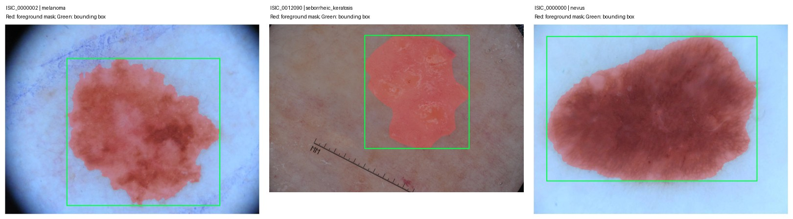

# Real-data sample audit

Date: 2026-10-28. Run `python prepare_samples.py` after `python audit_labels.py`.

## Evidence

Selected the first training-label entry for each class, independent of model results:

| Image | Training diagnosis | Image and mask dimensions |
|---|---|---|
| ISIC_0000002 | melanoma | 1022 x 767 |
| ISIC_0012090 | seborrheic keratosis | 4288 x 2848 |
| ISIC_0000000 | nevus | 1022 x 767 |

The official 2017 training-mask archive was downloaded (not the multi-GB image archive), and three corresponding full images were downloaded through the current official Archive API. The image identifiers and dimensions agree with the 2017 masks. Overlays were visually inspected: the red mask covers the annotated lesion, and the green box encloses the mask, without an apparent orientation or scale mismatch in these examples. These checks do not prove that the current JPEG encoding is identical to the original challenge archive.

**This figure shows ground-truth annotation conversion, not predictions. No model has been trained.** The middle example contains a ruler outside the lesion box, demonstrating a potential localization distractor; no model failure is claimed.

Raw images, masks, API JSON and the mask ZIP are stored under ignored `data/`. Source URLs, image/mask hashes, class mappings and image licenses are recorded in `sample_audit.json`. All three sampled image metadata records report CC-0 and Anonymous attribution. Cite the ISIC 2017 dataset when using these figures.

## Patient-level limitation

No patient identifier was present in the three inspected API records; the train/validation diagnosis CSVs also lack it. This sample inspection does not establish that all Archive records lack patient identifiers. Patient independence is still unverified. Do not substitute age/sex/image ID as a patient identity. Obtain a trustworthy patient mapping or discuss the missing metadata and acceptable split protocol with the tutor. Retain this limitation in the final report if unresolved; do not silently relax the exporter's patient checks.

## Next milestone

Develop model/training/inference entry points with reproducible settings, then conduct a small feasibility smoke test once data usage and split policy are documented. A development smoke test must not be reported as an independent test-set benchmark. Final scientific evaluation still requires the agreed leakage prevention protocol and identical splits across comparisons.

Sources:

- https://challenge.isic-archive.com/data/#2017
- https://api.isic-archive.com/api/docs/swagger/
- https://arxiv.org/abs/1710.05006
